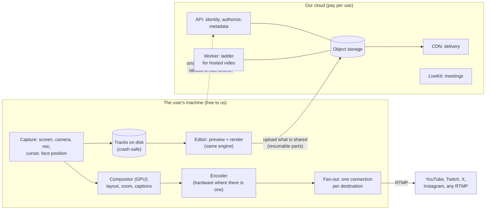

# Studio system design

How the desktop studio, the extension and the editor are built so that **the user's own machine does
the work and we do not pay for it**, and what we do pay for, how that grows, and what we measure and
promise. The server side (API, hosting, share links) is in [backend.md](backend.md) and the idea
behind it is in the [README](../README.md). This document is the other half: the client.

Status: design, not built. Numbers marked *target* are what we will hold ourselves to; numbers marked
*measured* come from the running system; anything else is an assumption and says so.

## 1. The principle

> **The user's computer is the factory. Our cloud is the front desk.**

Work that is bound by one person's CPU, GPU, disk or uplink, and that nobody else needs to run for
them, runs on that person's machine: capturing, compositing, encoding, fanning a stream out to
several platforms, recording to disk, previewing and rendering an edit, captions, face tracking for
reframing. The cloud does only what has to be shared or trusted: who you are, small authorizing
calls, metadata, storing and delivering what is shared, live rooms with other people, billing.

The same rule as the server side ("our servers decide; they never carry the bytes"), applied one
level out: **our servers do not do the work either, unless the user asks and pays for it.**

## 2. What costs us money, and what does not

| Activity | Whose resources | Our cost |
| --- | --- | --- |
| Recording to disk, preview, editing, export | The user's CPU/GPU/disk | None |
| Going live to several platforms | The user's encoder and uplink; platforms take ingest for free | None (credentials only) |
| Captions, face tracking, reframing | The user's CPU/GPU (local models) | None |
| Uploading a recording to the library | The user's uplink; object storage ingress is free | Storage, per GB-month |
| Someone watching a shared or hosted video | CDN egress | **Per GB watched: the main variable cost** |
| Making the quality ladder for hosted video | Our worker | Per video minute (or none, if the studio encodes the ladder on the machine before upload) |
| Live meetings (LiveKit) | Our SFU | Per participant-minute (egress per subscriber) |
| Cloud restream and cloud render (optional, paid) | Our servers | Real, and priced into the plan that includes them |

So the cost drivers are three, and each is something users choose to use: **storage kept, video
watched, and meetings held.** Everything else scales with their hardware, not our bill. Pricing
follows the drivers (limits on hosted hours and watched hours per plan), not the features.

A cost model is only as good as its inputs, so measure them before pricing: bytes stored per minute of
source across the whole ladder (from real encodes by the worker), CDN price per GB at our expected
volume (public price lists run from a few cents down to under a cent per GB with volume and provider;
check current prices), average watch fraction of a shared video. Until then any number here would be
a guess. The raw tracks of a recording stay on the machine by default: uploading them is what would
multiply storage, so it is an opt-in, paid sync, not the default.

## 3. The honest trade-off of fanning out locally

"Encode once, push to every destination" means the user's **uplink carries every copy**. Three
destinations at 6 Mbps need about 18 Mbps up, which many home connections do not have. A cloud
restreamer takes one upload and fans out from its side, and charges for that egress; going local
moves the cost to the user's connection. That is the right default (it is free and has no extra hop),
but it has to be designed for:

1. **Measure before going live.** The studio tests the uplink and the destination ingests, shows the
   headroom, and lowers bitrates, or says which destination to untick, before the user is live.
2. **One encode per aspect ratio, not per destination.** Wide and tall are two encodes (two
   resolutions cannot share one). Destinations of the same shape share an encode, at the lowest
   bitrate any of them allows. Fewer encodes is less CPU, less heat, fewer hardware-encoder sessions
   (consumer GPUs have historically limited concurrent hardware encode sessions; check the limit on
   each target driver).
3. **An optional paid relay** for people with weak uplinks: one upload to us, we fan out. Here our
   cloud does the work and the egress, so it is a paid feature. It is the only place the studio
   routes the stream through our servers, and only when asked.
4. **Destinations are isolated.** Each has its own connection and its own retry. One platform dropping
   must not touch the others or the recording.

## 4. Failure design

The rule: **once going live starts, it must not depend on our servers.** Credentials and tokens are
fetched before the button is pressed and refreshed ahead of expiry; telemetry is best effort. If our
API is down, the stream continues.

| What fails | What happens |
| --- | --- |
| The app or machine crashes while recording | Tracks are written as fragmented files, flushed about every second, so at most the last moment is lost; on restart the studio finds the unfinished recording and offers to recover it |
| A destination drops | Reconnect with backoff, per destination; the others and the local recording continue; the user sees which one and for how long |
| The uplink collapses | Bitrate adapts down, then frames are dropped before the picture stalls; the recording on disk is unaffected, and it is at full quality, so the edit can be exported and uploaded afterwards |
| The disk fills | Warned early (free space against bitrate), and a recording is stopped cleanly rather than corrupted |
| Sleep, wake, a camera unplugged, a display change | Capture sources are re-opened; the stream shows a "reconnecting source" card instead of a freeze |
| Audio and video drift | One master clock; audio is resampled to it; drift beyond a threshold is corrected, not accumulated |
| An upload is interrupted | Resumable parts from the local file (built on the server side); the link works as soon as the first part is playable |
| A bad update | Signed updates, staged rollout, and a one-step rollback to the last version that worked |

The recording on disk is the source of truth, and the stream is a best-effort live view of it. That
is why a bad connection ruins a live broadcast but never a recording.

### Bad networks, specifically

A live stream cannot be better than the first mile, the user's own connection, and no design changes
that, including a cloud restreamer (it too is fed over that connection). What a design can change is how
much damage a bad connection does, and how the studio behaves while it lasts:

| What the network does | What the studio does | What viewers see |
| --- | --- | --- |
| A blip of a second or two | A send buffer of a few seconds absorbs it (this adds that much delay, so its size is a setting) | Nothing |
| Sustained congestion | The encoder's bitrate is lowered step by step; if that is not enough, frames are dropped before the picture is allowed to stall; it recovers upward slowly, and only when the connection has held | Softer picture, then lower frame rate, but it keeps playing |
| An outage | Recording continues at full quality; the studio keeps trying to reconnect each destination; the user is told plainly ("stream down for 40 s") | The platform shows the stream as interrupted; platforms differ in how long they hold a broadcast open for a reconnect (to be checked for each one, not assumed) |
| The connection returns | Destinations reconnect on their own; the live view resumes | The stream resumes; the gap stays a gap |
| Afterwards | The full-quality recording is complete and can be published as the replay, so the gap exists only in the live view | The replay has no gap |

Two things make this better than it sounds. First, the user is **warned before it happens**: the
studio measures the uplink before going live and keeps measuring (a live indicator with real numbers),
so a user can switch to a weaker setting or a second connection on purpose. Second, an optional second
route (failover to a phone's hotspot or another network adapter) is a later feature, not a promise.

What a cloud relay changes, honestly: it needs one upload instead of one per destination, which helps a
weak uplink a lot, and while the user's connection is down it can keep the platform connections open
and show a "be right back" card, which a purely local stream cannot do. It does not make a dead
connection live. That is why it is the paid option, not the default.

**Consequence for the encoder.** Lowering the bitrate while live needs control of the encoder while it
runs. A bundled ffmpeg command line cannot change its bitrate mid-run without restarting (a visible
interruption). So the live path needs libav or the hardware encoder's own API in a native module, and
ffmpeg as a separate process stays for recording and export. This changes the decision in section 11.

## 5. Latency and quality: what we control, and what we measure

Latency as the viewer feels it is mostly not ours: each platform ingests, transcodes and buffers before
anyone sees a frame, and a local app cannot shorten that. What is ours, and what we will measure and
publish:

| Measure | Target | How |
| --- | --- | --- |
| Go-live time: button pressed to the first frame accepted by the destination | under 3 s | Timed in the studio, per platform |
| Encoder latency: frame captured to frame encoded | under 100 ms with a hardware encoder | Instrumented frame timestamps |
| Dropped frames over a 1 hour stream at 1080p60 to three destinations | under 0.1% | Soak test on reference machines |
| Audio and video sync | within 40 ms, with no drift over an hour | Clap test and clock logging |
| CPU and GPU use while streaming and recording | Stay under a budget per tier of machine, published | Reference machines (low, mid, high) |
| Time from stopping a recording to a working share link | under 1 s on a normal connection (extension) | Already a plan item |

Method: a fixed scenario matrix on three reference Windows machines, run in CI-style soak tests, with
OBS and Streamlabs as baselines (we have them on Windows). A comparison with Vidyst has to wait for a
Mac (planned for the macOS month); until then no claim about it is made. The only public statement
found about Vidyst is its own, that streams go from the user's machine with no cloud relay, which is
the same principle as above.

## 6. The editor on the machine

The editor reads the **tracks** (screen, camera, mic, cursor and click data, a face-position track)
and a **timeline document** (versioned JSON), and one composition engine produces both the preview and
the final render, so they cannot differ. Rendering runs on the user's GPU. Nothing about editing needs
our servers, which is why it is free to offer. See `DAILY_PLAN.md` v2.7 for the quality bar and the
catalog of layouts, captions and transitions.

External tools are trials, not commitments. Each one that is tried (a render engine, an animation
library, a 3D or physics piece) is **kept only if it passes**: the result beats the reference tool in a
side-by-side, it renders at least in real time on the mid reference machine, its licence allows what
we build with it, its size and upkeep are acceptable. If it does not pass it is removed, and the
catalog does not depend on it.

## 7. Projects and sync

A project is a folder: the tracks, a metadata file, the timeline document. It is local first and works
offline. The cloud holds the library entry (the recording row that exists today), the hosted
renditions, and, as an option, the timeline document and low-resolution proxies so a project can be
opened elsewhere. Edits to a synced project use the same optimistic concurrency as recordings today
(a version in `If-Match`; a stale writer gets a `409` and a choice, never a silent overwrite). Raw
tracks sync only if the user chooses, because they are the big files.

## 8. Security and privacy

- Stream keys and tokens are kept in the operating system's credential store (Windows Credential
  Manager, macOS Keychain), never in a plain file; the server stores OAuth tokens encrypted.
- What is recorded stays on the machine unless the user shares it. Telemetry is opt-in, carries
  health numbers (bitrate, dropped frames, reconnects) and never content.
- Installers are code-signed; updates are signed and checked before they run.
- A share link is a capability, and revoking it has limits that are written down, not hidden: see
  *Revoking a viewing* in [backend.md](backend.md). A key that changes every 30 seconds of video ends a
  viewing in progress within about half a minute; a tool that collects every period's key is not stopped.

## 9. How the server side scales

What is measured today: a library page 0.15 ms on 200,000 recordings; a share-link lookup 1.2 ms
(about 3,000 a second over 16 clients); a visitor start about 780 a second end to end; 10,000 views
written as 5 rows; a share page reused for 15 seconds, so a link costs the API about four requests a
minute however many open it. What gives first, and the step for each (do the step when the trigger is
seen, not before):

| Likely first limit | Trigger | Step |
| --- | --- | --- |
| Postgres connections | Pool waits in the metrics | PgBouncer in front; keep transactions short (already the rule) |
| Playback session inserts | Insert latency climbs, table growth | Partition `playback_sessions` by day; sessions already expire and are swept |
| Key server per-request database check | p95 of key requests | A short Redis cache of the access answer (a few seconds, which trades instant revocation for fewer reads; revocation is already not instant for a holder of the key) |
| The API's address limiter seeing one web server | Cache-miss traffic on `/s` | An internal-caller exemption so the web server's own calls are not counted as one visitor |
| Redis (limits, counters, views) | Memory or CPU | Replica, then cluster; the counters are already sharded by key |
| Worker throughput | Queue age | More workers; jobs are leased and idempotent, so this is only adding copies |
| CDN egress cost | The bill | Longer cache lifetimes, regional pricing, encode the ladder with better codecs (AV1 or HEVC) where players allow |
| Meetings | SFU CPU and egress | LiveKit nodes per region; cap room sizes by plan |

## 10. Build order

Each step ends with something that runs, and the hard-to-retrofit parts come first.

1. **Capture and crash-safe local recording** (M2 start). Tracks and the data the editor needs (cursor,
   clicks, face position) are recorded from the first recording, not added later. A kill-the-process
   test: the recording recovers.
2. **The composition engine spike** (Days 46 to 48, before any editor screen): screen, camera bubble,
   cursor smoothing and zoom, rendered deterministically, compared with the reference.
3. **Encoder and one destination**, with the go-live time and dropped-frame instrumentation from the
   first day, not after, and with live bitrate adaptation designed in (the encoder must be one whose
   bitrate can change while it runs).
4. **Several destinations**, the uplink check, per-destination isolation, the soak tests (M3).
5. **The editor on the engine** (M4), with the keep-or-cut rule applied to every external tool.
6. **Relay and cloud render as paid options** only if users with weak machines or uplinks ask for
   them.

## 11. Decisions still open

| Question | Leaning | Decided by |
| --- | --- | --- |
| Encoding: a bundled ffmpeg process, or libav in a native module | ffmpeg as a process for recording and export. For **live**, libav or the hardware encoder's API in a native module, because adapting the bitrate while live (see *Bad networks*) needs control of the running encoder; decide with the first stream tests | The Day 48 spike and the first stream tests |
| Render engine for the editor | HyperFrames or Remotion, by measurement | The Day 46 to 48 spike |
| Encode the hosted ladder on the machine instead of on our worker | Offer it later, once the studio exists; it saves our compute and costs the user time and battery | Measured cost per video minute |
| Project sync: default or opt-in | Opt-in, paid | Storage cost model (section 2) |
| Relay: build or resell | Decide only if asked for | Demand |
